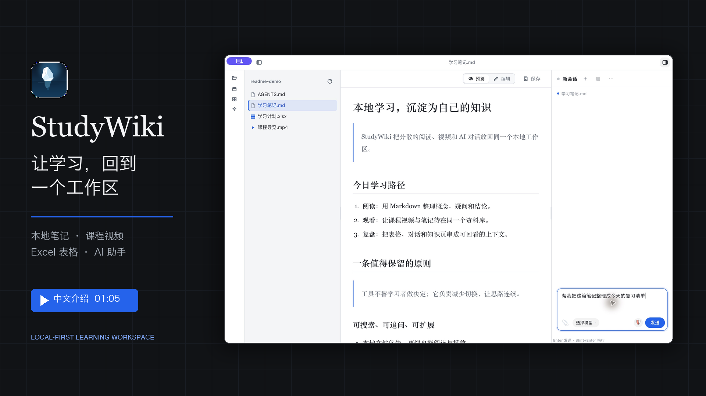

# StudyWiki

English | [中文](README.md)

**Bring local notes, course videos, and AI assistance into one extensible learning workspace.**

[](docs/assets/studywiki-intro.mp4)

[▶ Watch the Chinese video tour (about 1 minute)](docs/assets/studywiki-intro.mp4)

## One library, four connected experiences

- **Read and watch**: Open Markdown, Excel, and local videos in one window.
- **Organize and review**: Stay in context with the file tree, editor preview, and search.
- **Work with Agent**: Read and search the current library; approve writes and resume sessions.
- **Build and extend**: Organize knowledge with llm-wiki and extend it with external plugins.

## Quick start

Build from source:

```sh
pnpm install        # 安装构建依赖
pnpm tauri dev      # 启动开发模式
pnpm tauri build    # 构建桌面安装包
```

Building requires Node ≥ 22, pnpm ≥ 10, and Rust stable. See the [development guide](docs/development.en.md) for platform toolchains.

## Local first, with clear boundaries

Reading and playback work fully offline; online models and plugin installation are network exceptions. Shipped artifacts need no separate runtime installation. See [environment independence](docs/environment-independence.en.md) for the complete boundaries.

## Learn more

- [Architecture and data flow](docs/architecture.en.md)
- [Plugin authoring guide](docs/plugins/authoring.en.md)
- [Contributing and quality gates](docs/development.en.md)
- [Product roadmap](.agents/flow/roadmap.en.md)
